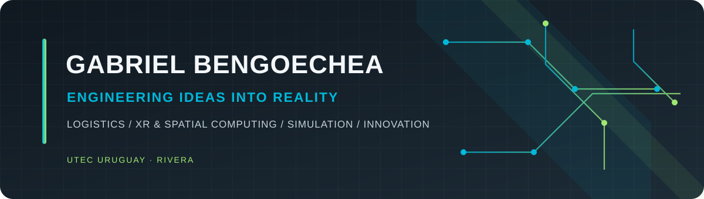
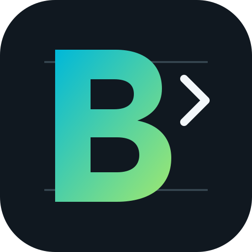

  

<h3 align="center">Engineering ideas into real-world solutions.</h3>

  Logistics Engineering student at <strong>UTEC Uruguay</strong> · XR, simulation & emerging technology · Rivera, Uruguay

---

## About

I study **Logistics Engineering at UTEC Uruguay** and explore how engineering, software and emerging technologies can make complex systems easier to understand, operate and teach.

My work connects practical logistics problems with experimentation: route optimization, inventory and port operations, immersive VR training, interactive 3D simulation and spatial computing. I build with an **AI-assisted workflow** and value projects that move beyond concepts and become useful, testable experiences.

## Areas of interest

| Area | What I explore |
|---|---|
| **Logistics & systems** | Supply chains, outbound transport, inventory models, port operations and route optimization |
| **XR & spatial computing** | Virtual and mixed reality for Meta Quest, WebXR, immersive training environments |
| **AI & automation** | AI-assisted development and practical applications of intelligent systems |
| **Simulation & 3D** | Interactive models, digital-twin-style visualization and learning environments |
| **Space & emerging technology** | Microgravity logistics, CubeSats and human-centered exploration projects |

## Featured work

### [Artigas-1 · XR Logística Lab](https://github.com/gabrielbengoechea/xr-logistica-lab)
A mixed-reality lab for teaching logistics and engineering on Meta Quest. Students assemble real equipment (forklift, pallet, selective rack, photoelectric sensor, three-phase motor, CubeSat 1U) in exploded view while the headset streams session metrics to a teacher dashboard. Includes **Artigas-1**, a zero-gravity logistics simulator aboard a fictional Uruguayan space station.

`Unity 6` `C#` `OpenXR` `FastAPI` `React` `three.js` `Blender`

### [Quest XR Pilots](https://github.com/gabrielbengoechea/quest-xr-pilotos)
A collection of browser-based WebXR pilots for Meta Quest: a mixed-reality port atlas with 30 ports and strategic chokepoints, a forklift driving trainer set in a Uruguayan warehouse, a 6-axis industrial robot, an exploded turbofan engine and tabletop AR placement.

`WebXR` `three.js` `Blender`

### [Dijkstra Logistics Master](https://github.com/gabrielbengoechea/rutas-dijkstra)
An interactive web tool for outbound transport: step-by-step visualization of Dijkstra's shortest-path algorithm on a distribution network, with fuel/cost savings estimates, practical cases and a quiz.

`HTML` `JavaScript` `Tailwind CSS`

### [Incoterms 2020 Master](https://github.com/gabrielbengoechea/incoterms-2020-learning)
An interactive learning platform for international trade: cost and risk transfer visualizer for the 11 ICC Incoterms® 2020 rules, a selection assistant, a comparison matrix and practice cases.

`HTML` `JavaScript` `Tailwind CSS`

### VR walkthroughs for logistics simulators
I added Meta Quest VR walkthroughs (collision-aware walking, teleport, illustrated tutorial) to three classroom simulators originally created by [@sr-sebastian](https://github.com/sr-sebastian):
[Logística 3D](https://github.com/gabrielbengoechea/logistica3d) (Montevideo port terminal) ·
[Centro Logístico 3D](https://github.com/gabrielbengoechea/logi) (distribution center) ·
[Estiba](https://github.com/gabrielbengoechea/Estiba-VR) (container stowage).

> These three repositories are forks. The original simulators belong to their upstream author; my contribution is the VR layer and related improvements documented in each README.

## Tools & technologies

  
  
  
  
  
  
  
  

## Background

- **Logistics Engineering**, UTEC Uruguay (in progress).
- Diploma program in **Intelligent Transport Management** — Tec de Monterrey + UTEC (Uruguay Global), AI applied to Industry 5.0.
- **Local Lead**, NASA Space Apps Challenge — Rivera, Uruguay.
- Languages: Spanish, English, Portuguese.

## Current direction

- Refining Artigas-1 and testing it on Meta Quest hardware.
- Connecting logistics models (inventory, routing, stowage) with simulation and XR.
- Documenting projects in English and Spanish so others can learn from and reuse them.

---

   
  Rivera, Uruguay · Learning by building.

